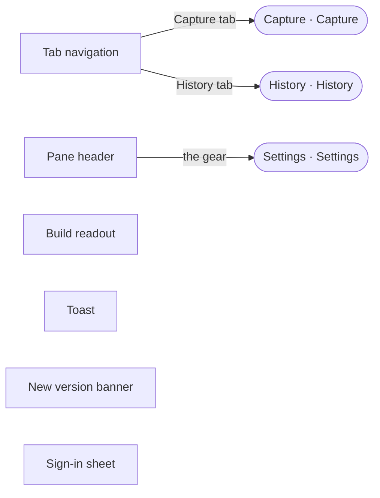
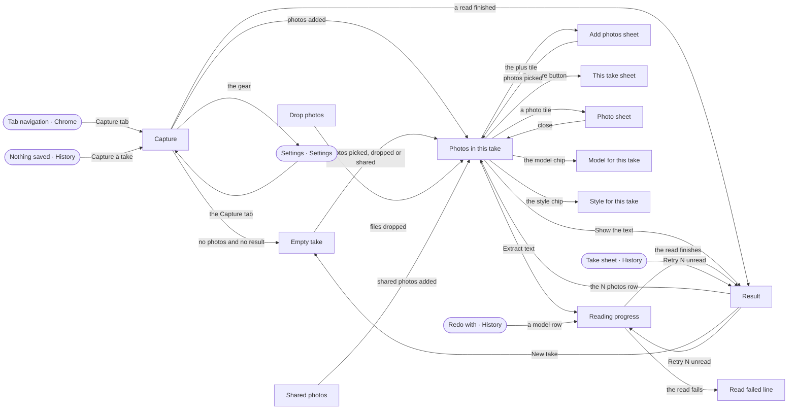
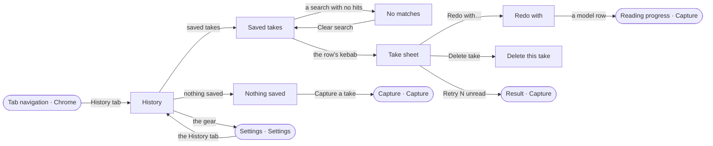
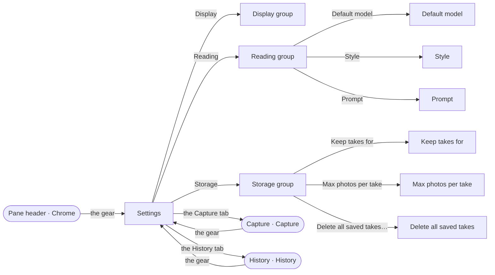
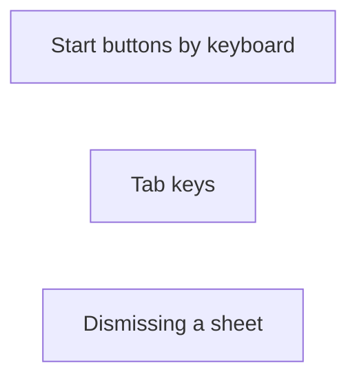

<!-- Generated from docs/ux-surfaces.yaml by scripts/ux_surface_map.py. Do not edit: change the map and re-run. -->

# UX surface map: photo-ocr

Every surface a person can reach in this app, each under a stable id that its root element carries as `data-surface`. Each area has a diagram of how its surfaces connect; a rounded node is a surface in another area.

One single-page app served at `/`. Phone first: a floating bottom-tab pill switches Capture and History, and Settings is the header gear of every pane, never a tab. On a mouse screen of 1100px and wider the same nav becomes a vertical rail. Every secondary choice opens in one sheet (a native dialog built by sheet.js) that a backdrop tap, Escape and the × all dismiss; a confirm stacks over the sheet that asked for it. A take is the unit of work: add photos, read them with one model and style, copy the text. Settings rows save to the server as they change and confirm with a toast. Per-take choices (model, style, Save to history) live on the Capture card; Settings holds the defaults a new take starts from. Nothing here is built from a runtime id, so every `data-surface` is a constant.

Walked 2026-11-18 against build `e2e05dc`, at widths 390, 1280, themes light, dark.

## Areas

| Area | Surfaces |
|---|---|
| [Chrome](#chrome) | 6 |
| [Capture](#capture) | 13 |
| [History](#history) | 7 |
| [Settings](#settings) | 10 |
| [Keys and gestures](#keys-and-gestures) | 3 |

## Chrome

What frames every pane, and the two overlays the app raises on its own.

### `chrome.nav` Tab navigation

- **Root:** `data-surface`
- **Reach:** always on screen once a pane shows
- **Holds:** a Capture tab and a History tab
- **Does:**
  - switches the pane and remembers the tab for the next launch
  - choosing either tab leaves Settings
  - opening History reloads its list
- **States:** no tab is selected while Settings is open
- **Phone:** a floating pill at the bottom of a touch screen; a narrow window with a mouse puts it across the top
- **Desktop:** a vertical rail on a mouse screen of 1100px or wider
- **Why:** the fleet navigation contract; Settings is never a tab, so the pill holds only the two working views
- **Leads to:**
  - [Capture](#capturepane-capture) (Capture tab)
  - [History](#historypane-history) (History tab)

### `chrome.header` Pane header

- **Root:** none — the same header card sits at the top of each pane and carries no id of its own
- **Reach:** the top of the Capture, History and Settings panes
- **Holds:**
  - the pane's icon and title
  - an exception line, empty when nothing is wrong (Capture and History only)
  - a sun or moon button
  - a gear button
- **Does:**
  - the sun or moon toggles light and dark and remembers the choice
  - the gear opens Settings
- **States:**
  - Capture names at most two exceptions: Reading, N failed, Uploading N, N photos unread, N blurry or dark or glare, Not saved to History
  - History names how many loaded takes are partly read
- **Why:** the header says only what is out of the ordinary, so a normal take leaves it quiet
- **Leads to:** [Settings](#settingspane-settings) (the gear)

### `chrome.page-foot` Build readout

- **Root:** `data-surface`
- **Reach:** the foot of every pane
- **Holds:** the git sha and build time the page is running
- **States:** blank when the version call fails
- **Why:** answers "is the phone running the current code" from any tab

### `chrome.toast` Toast

- **Root:** `data-surface`
- **Reach:** raised by an action's outcome
- **Holds:** one line of text
- **Does:**
  - confirms a save, a copy or a finished read
  - names a failure, tinted as an error
- **States:**
  - errors: upload, delete, save, copy, search, retry and boot failures, a skipped non-image, the photo cap, and the three share problems
  - locked: Photos are locked while a read is running
- **Why:** the one fleet toast; only an error tints

### `app.update-banner` New version banner

- **Root:** `data-surface`
- **Reach:** appears when the server runs a newer build than the page
- **Holds:**
  - the text New version available
  - a Reload button
  - a dismiss button
- **Does:**
  - Reload reloads the page, only ever on a tap
  - dismiss keeps it down until the server moves to yet another build
- **Why:** a vendored component stamps this id itself

### `shared.login` Sign-in sheet

- **Root:** `data-surface`
- **Reach:** any call the server answers with 401
- **Holds:**
  - a password field
  - an error line
  - a Sign in button
- **Does:** a correct password closes the sheet and boots the app again
- **States:** locked out after repeated wrong passwords
- **Why:** a vendored component stamps this id itself, so the app has no call site for it

## Capture

The default tab. One card shows one of three views of the take, with the sheets it opens.

### `capture.pane` Capture

- **Root:** `data-surface`
- **Reach:**
  - the Capture tab
  - the first screen on every launch, unless the last tab was History
- **Holds:**
  - the pane header
  - one take card showing the empty, photos or result view
  - the build readout
- **Does:** holds the take until Start over or New take, across tab switches
- **Why:** Capture is the phone's landing view, so the empty take offers its two starts at once
- **Leads to:**
  - [Empty take](#captureempty-empty-take) (no photos and no result)
  - [Photos in this take](#capturetake-photos-photos-in-this-take) (photos added)
  - [Result](#captureresult-result) (a read finished)
  - [Settings](#settingspane-settings) (the gear)

### `capture.empty` Empty take

- **Root:** `data-surface`
- **Reach:**
  - a fresh launch
  - after Start over or New take
- **Holds:**
  - the empty-state block saying Add photos of a page, a screen or a document
  - Choose photos as the primary
  - Camera as the second start
- **Does:**
  - Choose photos opens the device's photo picker (multiple)
  - Camera opens the camera
- **States:** a pick or a drop that is not an image is skipped with a toast
- **Why:** takes mostly start from screenshots, so Choose photos leads and Camera follows
- **Leads to:** [Photos in this take](#capturetake-photos-photos-in-this-take) (photos picked, dropped or shared)

### `capture.take-photos` Photos in this take

- **Root:** `data-surface`
- **Reach:**
  - the first photo added
  - the N photos row on the result
- **Holds:**
  - a Show the text row when a result exists
  - the photo strip, one tile per photo, then a plus tile
  - this take's model chip and style chip
  - the Save to history switch
  - the Extract text button (Extract again with a result) and a more button
- **Does:**
  - a tile opens that photo's sheet
  - the plus tile opens the Add photos sheet
  - the chips open the model and style pickers
  - the switch saves or withholds the take from History, and puts itself back if the server refuses
  - Extract text starts a read
  - the more button opens the This take sheet
- **States:**
  - a tile shows its upload state: uploading, ready or failed
  - a tile carries a Blurry, Dark or Glare chip when the on-device check warns; the warning is advice and never blocks Extract
  - while a read runs, the plus tile, Extract and the switch are disabled and a tile tap only toasts
  - at the take's photo cap the plus tile is disabled
  - Extract is hidden until a photo is ready
- **Why:** the strip is the take's only list, so the add tile ends it instead of a separate button
- **Leads to:**
  - [Photo sheet](#capturephoto-sheet-photo-sheet) (a photo tile)
  - [Add photos sheet](#captureadd-sheet-add-photos-sheet) (the plus tile)
  - [Model for this take](#capturemodel-picker-model-for-this-take) (the model chip)
  - [Style for this take](#capturestyle-picker-style-for-this-take) (the style chip)
  - [This take sheet](#capturetake-more-sheet-this-take-sheet) (the more button)
  - [Reading progress](#captureextracting-reading-progress) (Extract text)
  - [Result](#captureresult-result) (Show the text)

### `capture.extracting` Reading progress

- **Root:** `data-surface`
- **Reach:** Extract text, Retry missing or Redo from History
- **Holds:**
  - a progress meter measured in job parts, never photos
  - a label naming the step
- **States:** the label starts as Reading, Redo or Retry followed by starting
- **Why:** a job is measured in parts so a slow photo never makes the bar run backwards
- **Leads to:**
  - [Result](#captureresult-result) (the read finishes)
  - [Read failed line](#captureerror-read-failed-line) (the read fails)

### `capture.error` Read failed line

- **Root:** `data-surface`
- **Reach:** a failed Extract, Redo or Retry
- **Holds:** the server's own message
- **States:**
  - the hub being down and the hub still working past the timeout read differently
  - cleared when the next job starts
- **Why:** a failed job is told in the server's words, with a toast beside it

### `capture.result` Result

- **Root:** `data-surface`
- **Reach:**
  - a finished read
  - Show the text on the photos view
  - Redo or Retry from a History take adopts that take here
- **Holds:**
  - an N photos row that leads back to the photos
  - a meta line with the model, time, whether it was cached and whether it was saved to History
  - the text, editable
  - Copy text as the primary
  - New take
  - Retry N unread on a partly read take
- **Does:**
  - editing the text changes what Copy copies
  - Copy text copies, then shows Copied for a moment
  - New take drops the photos and the text
  - Retry N unread re-reads only the photos that failed
- **States:**
  - no readable text: a line says so and Copy is hidden
  - partly read: the header counts N photos unread and Retry N unread shows
  - Retry is withheld once the photos changed since the read, because the server refuses it then
  - a History take has no photos here, so the N photos row is absent
- **Why:** a result takes the card until the person asks for the photos, so the text is the first thing they see
- **Leads to:**
  - [Photos in this take](#capturetake-photos-photos-in-this-take) (the N photos row)
  - [Empty take](#captureempty-empty-take) (New take)
  - [Reading progress](#captureextracting-reading-progress) (Retry N unread)

### `capture.add-sheet` Add photos sheet

- **Root:** `data-surface`
- **Reach:** the strip's plus tile
- **Holds:**
  - Choose photos
  - Camera
- **Does:** each closes the sheet and opens the matching picker
- **Leads to:** [Photos in this take](#capturetake-photos-photos-in-this-take) (photos picked)

### `capture.take-more-sheet` This take sheet

- **Root:** `data-surface`
- **Reach:** the more button beside Extract
- **Holds:** Start over
- **Does:** Start over drops the photos and the text at once, with no confirm
- **Why:** the result's New take does the same, so neither asks

### `capture.photo-sheet` Photo sheet

- **Root:** `data-surface`
- **Reach:** a photo tile
- **Holds:**
  - the title Photo N of M
  - the photo whole, in a box reserved before it loads
  - a warning line for a warned photo
  - Move left and Move right
  - Retake and Keep it, for a warned photo
  - Remove photo, last, in the danger tint
- **Does:**
  - Move left and Move right reorder the take and keep the sheet open on the same photo
  - Retake removes the photo and opens the camera
  - Keep it dismisses the warning
  - Remove photo deletes the photo
- **States:**
  - the move buttons disable at the strip's ends
  - closing returns focus to the photo's tile, or to its neighbour once it is gone
- **Why:** moving a photo keeps the sheet open so a photo can be walked along the strip
- **Leads to:** [Photos in this take](#capturetake-photos-photos-in-this-take) (close)

### `capture.model-picker` Model for this take

- **Root:** `data-surface`
- **Reach:** the model chip
- **Holds:** one row per model the hub offers, the take's own marked with a check
- **Does:** a row sets this take's model and closes the sheet
- **Why:** the choice is per take; Settings keeps the default

### `capture.style-picker` Style for this take

- **Root:** `data-surface`
- **Reach:** the style chip
- **Holds:** one row per prompt style, the take's own marked with a check
- **Does:** a row sets this take's style and closes the sheet
- **Why:** the choice is per take; Settings keeps the default

### `capture.drop` Drop photos

- **Root:** none — a drop is handled on the whole page and shows no element of its own
- **Reach:** dragging image files onto the page, on a desktop
- **Does:** adds them to the take as if picked
- **States:**
  - locked with a toast while a read runs, and refused at the photo cap
  - a History take showing on Capture is replaced by a new take first
- **Phone:** not reachable
- **Leads to:** [Photos in this take](#capturetake-photos-photos-in-this-take) (files dropped)

### `capture.shared` Shared photos

- **Root:** none — photos shared from the Android share sheet arrive on Capture and draw no surface of their own
- **Reach:** the installed app chosen in the Android share sheet
- **Does:** a service worker parks the photos, the page switches to Capture and adds them to the take
- **States:** a share with no photos, one that arrived before the app was ready, and one that could not be read each end in an error toast
- **Phone:** Android installed app only
- **Leads to:** [Photos in this take](#capturetake-photos-photos-in-this-take) (shared photos added)

## History

### `history.pane` History

- **Root:** `data-surface`
- **Reach:** the History tab
- **Holds:**
  - the pane header
  - the saved takes under date overlines
  - the build readout
- **Does:** the list reloads every time the tab opens
- **Why:** there is no Refresh button because opening the tab is the refresh
- **Leads to:**
  - [Saved takes](#historylist-saved-takes) (saved takes)
  - [Nothing saved](#historyempty-nothing-saved) (nothing saved)
  - [Settings](#settingspane-settings) (the gear)

### `history.list` Saved takes

- **Root:** `data-surface`
- **Reach:** the History tab
- **Holds:**
  - a search field, when the server has search on
  - takes under date overlines, newest first
  - each row with a snippet, the model, the time, any exception chip and the photo count
  - a kebab on each row
  - Load more, with the count left
- **Does:**
  - a tap on a row copies that take's text and toasts the length
  - the kebab opens the take's sheet
  - typing searches the saved text after a short pause
  - Load more appends the next page
- **States:**
  - a search shows ranked hits with snippets and no date overlines, and no Load more
  - chips mark a partly read, failed or still reading take
- **Why:** the row tap copies because copying is what a saved take is for; the kebab holds the rest
- **Leads to:**
  - [Take sheet](#historytake-sheet-take-sheet) (the row's kebab)
  - [No matches](#historyno-matches-no-matches) (a search with no hits)

### `history.empty` Nothing saved

- **Root:** `data-surface`
- **Reach:** History with no saved takes
- **Holds:**
  - the empty-state block saying No saved takes
  - how many days takes are kept, when Save to history is on
  - a Capture a take button
- **Does:** Capture a take switches to the Capture tab
- **Leads to:** [Capture](#capturepane-capture) (Capture a take)

### `history.no-matches` No matches

- **Root:** `data-surface`
- **Reach:** a search that finds nothing
- **Holds:**
  - the empty-state block naming the query
  - a Clear search button
- **Does:** Clear search empties the field and returns to the list
- **Leads to:** [Saved takes](#historylist-saved-takes) (Clear search)

### `history.take-sheet` Take sheet

- **Root:** `data-surface`
- **Reach:** a History row's kebab
- **Holds:**
  - the take's date and time as the title
  - a meta line with the photo count, model, duration and exception chips
  - the take's text, read-only, in a box reserved before it arrives
  - Copy text as the primary
  - Retry N unread
  - Redo with…
  - Delete take, last, in the danger tint
- **Does:**
  - Copy text copies the take's text
  - Retry N unread re-reads the photos that failed and shows the result on Capture
  - Redo with… opens the model picker
  - Delete take asks first
- **States:**
  - loading: the text box reads Loading the text…
  - a failed redo keeps the last good text and says why the last read failed
  - a search hit does not know its unread photos, so Retry stays hidden until the server answers
- **Why:** the take's actions live in one sheet so a row stays a single tap target
- **Leads to:**
  - [Redo with](#historyredo-picker-redo-with) (Redo with…)
  - [Delete this take](#historyconfirm-delete-delete-this-take) (Delete take)
  - [Result](#captureresult-result) (Retry N unread)

### `history.redo-picker` Redo with

- **Root:** `data-surface`
- **Reach:** Redo with… on the take sheet
- **Holds:** one row per model, the take's own marked with a check
- **Does:** a row re-reads the take with that model and its own style, then shows the result on Capture
- **Leads to:** [Reading progress](#captureextracting-reading-progress) (a model row)

### `history.confirm-delete` Delete this take

- **Root:** `data-surface`
- **Reach:** Delete take on the take sheet
- **Holds:**
  - the question Delete this take?
  - a line saying the photos and text are deleted for good
  - Cancel and Delete
- **Does:**
  - Delete removes the take and reloads the list
  - Cancel, the ×, a backdrop tap and Escape all keep it
- **Why:** focus lands on Cancel so an Enter on an unread question cannot delete; this stacks over the take sheet

## Settings

### `settings.pane` Settings

- **Root:** `data-surface`
- **Reach:** the gear in any pane's header
- **Holds:**
  - the pane header, with its own sun or moon and gear
  - the Display, Reading and Storage groups
  - the build readout
- **Does:** each row saves to the server as it changes and toasts the result
- **States:** a failed save toasts and puts the row back
- **Why:** Settings is a pane over the tabs, not a tab, so the nav leaves no tab selected
- **Leads to:**
  - [Display group](#settingsdisplay-display-group) (Display)
  - [Reading group](#settingsreading-reading-group) (Reading)
  - [Storage group](#settingsstorage-storage-group) (Storage)
  - [Capture](#capturepane-capture) (the Capture tab)
  - [History](#historypane-history) (the History tab)

### `settings.display` Display group

- **Root:** `data-surface`
- **Reach:** Settings
- **Holds:** Text size as a Small, Default, Large control
- **Does:** a choice applies at once and is remembered on this device
- **Why:** changed often, so it stays inline instead of opening a sheet

### `settings.reading` Reading group

- **Root:** `data-surface`
- **Reach:** Settings
- **Holds:**
  - Default model with its current value
  - Style with its current value
  - Prompt, which reads View
- **Does:** each row opens its sheet
- **Leads to:**
  - [Default model](#settingsmodel-sheet-default-model) (Default model)
  - [Style](#settingsstyle-sheet-style) (Style)
  - [Prompt](#settingsprompt-sheet-prompt) (Prompt)

### `settings.storage` Storage group

- **Root:** `data-surface`
- **Reach:** Settings
- **Holds:**
  - Keep takes for with its current value
  - Max photos per take with its current value
  - Delete all saved takes…, in the danger tint
- **Does:**
  - the first two rows open their sheets
  - Delete all saved takes… asks first
- **Leads to:**
  - [Keep takes for](#settingsretention-sheet-keep-takes-for) (Keep takes for)
  - [Max photos per take](#settingsmax-photos-sheet-max-photos-per-take) (Max photos per take)
  - [Delete all saved takes](#settingsconfirm-delete-all-delete-all-saved-takes) (Delete all saved takes…)

### `settings.model-sheet` Default model

- **Root:** `data-surface`
- **Reach:** the Default model row
- **Holds:** one row per model the hub offers, the default marked with a check
- **Does:**
  - a row saves the default and toasts it
  - a take still on the old default follows the new one; a take whose chip was changed keeps its choice
- **Why:** the Capture chip changes one take; this changes where every new take starts

### `settings.style-sheet` Style

- **Root:** `data-surface`
- **Reach:** the Style row
- **Holds:** one row per prompt style, the default marked with a check
- **Does:** a row saves the default and toasts it

### `settings.prompt-sheet` Prompt

- **Root:** `data-surface`
- **Reach:** the Prompt row
- **Holds:**
  - a line naming the style it shows
  - the system prompt that style sends, read-only
- **Why:** read-only, so what the model is told is never a mystery and never editable by accident

### `settings.retention-sheet` Keep takes for

- **Root:** `data-surface`
- **Reach:** the Keep takes for row
- **Holds:**
  - four presets as one segmented control
  - a note under it
- **Does:** a preset saves, and the raised segment moves only once the server has it
- **States:** a stored value outside the presets raises no segment and is named in the note until a preset replaces it
- **Why:** presets, not a free number, because retention is a few clear choices

### `settings.max-photos-sheet` Max photos per take

- **Root:** `data-surface`
- **Reach:** the Max photos per take row
- **Holds:**
  - a number field for photos per take
  - an error line
- **Does:** the number saves when the field is left, or on Enter
- **States:** a value that is not a whole number from 1 to 100 is refused in place, with the error line, and the field returns to the saved value

### `settings.confirm-delete-all` Delete all saved takes

- **Root:** `data-surface`
- **Reach:** Delete all saved takes… in Settings
- **Holds:**
  - the question Delete all saved takes?
  - a line saying every take, with its photos and text, is deleted for good
  - Cancel and Delete all
- **Does:**
  - Delete all clears History and toasts
  - Cancel, the ×, a backdrop tap and Escape keep everything
- **Why:** the same confirm as one take's, with focus on Cancel

## Keys and gestures

### `keys.start-labels` Start buttons by keyboard

- **Root:** none — a key path on the empty take's two starts
- **Reach:** Enter or Space on Choose photos or Camera
- **Does:** opens the same picker a tap does
- **Why:** the starts are labels for hidden file inputs, the most reliable picker trigger on iOS, so they need their own key handling

### `keys.nav` Tab keys

- **Root:** none — a key path on the tab navigation
- **Reach:** focus on a tab
- **Does:** the arrow keys move between tabs, and Home and End jump to the first and last

### `keys.sheet-dismiss` Dismissing a sheet

- **Root:** none — every sheet dismisses the same way, so the paths are listed once here
- **Reach:** Escape, a tap on the backdrop or the ×
- **Does:**
  - closes the sheet and returns focus to what opened it
  - a confirm treats each as Cancel

## Link index

| From | Via | To |
|---|---|---|
| [Tab navigation](#chromenav-tab-navigation) | Capture tab | [Capture](#capturepane-capture) |
| [Tab navigation](#chromenav-tab-navigation) | History tab | [History](#historypane-history) |
| [Pane header](#chromeheader-pane-header) | the gear | [Settings](#settingspane-settings) |
| [Capture](#capturepane-capture) | no photos and no result | [Empty take](#captureempty-empty-take) |
| [Capture](#capturepane-capture) | photos added | [Photos in this take](#capturetake-photos-photos-in-this-take) |
| [Capture](#capturepane-capture) | a read finished | [Result](#captureresult-result) |
| [Capture](#capturepane-capture) | the gear | [Settings](#settingspane-settings) |
| [Empty take](#captureempty-empty-take) | photos picked, dropped or shared | [Photos in this take](#capturetake-photos-photos-in-this-take) |
| [Photos in this take](#capturetake-photos-photos-in-this-take) | a photo tile | [Photo sheet](#capturephoto-sheet-photo-sheet) |
| [Photos in this take](#capturetake-photos-photos-in-this-take) | the plus tile | [Add photos sheet](#captureadd-sheet-add-photos-sheet) |
| [Photos in this take](#capturetake-photos-photos-in-this-take) | the model chip | [Model for this take](#capturemodel-picker-model-for-this-take) |
| [Photos in this take](#capturetake-photos-photos-in-this-take) | the style chip | [Style for this take](#capturestyle-picker-style-for-this-take) |
| [Photos in this take](#capturetake-photos-photos-in-this-take) | the more button | [This take sheet](#capturetake-more-sheet-this-take-sheet) |
| [Photos in this take](#capturetake-photos-photos-in-this-take) | Extract text | [Reading progress](#captureextracting-reading-progress) |
| [Photos in this take](#capturetake-photos-photos-in-this-take) | Show the text | [Result](#captureresult-result) |
| [Reading progress](#captureextracting-reading-progress) | the read finishes | [Result](#captureresult-result) |
| [Reading progress](#captureextracting-reading-progress) | the read fails | [Read failed line](#captureerror-read-failed-line) |
| [Result](#captureresult-result) | the N photos row | [Photos in this take](#capturetake-photos-photos-in-this-take) |
| [Result](#captureresult-result) | New take | [Empty take](#captureempty-empty-take) |
| [Result](#captureresult-result) | Retry N unread | [Reading progress](#captureextracting-reading-progress) |
| [Add photos sheet](#captureadd-sheet-add-photos-sheet) | photos picked | [Photos in this take](#capturetake-photos-photos-in-this-take) |
| [Photo sheet](#capturephoto-sheet-photo-sheet) | close | [Photos in this take](#capturetake-photos-photos-in-this-take) |
| [History](#historypane-history) | saved takes | [Saved takes](#historylist-saved-takes) |
| [History](#historypane-history) | nothing saved | [Nothing saved](#historyempty-nothing-saved) |
| [History](#historypane-history) | the gear | [Settings](#settingspane-settings) |
| [Saved takes](#historylist-saved-takes) | the row's kebab | [Take sheet](#historytake-sheet-take-sheet) |
| [Saved takes](#historylist-saved-takes) | a search with no hits | [No matches](#historyno-matches-no-matches) |
| [Nothing saved](#historyempty-nothing-saved) | Capture a take | [Capture](#capturepane-capture) |
| [No matches](#historyno-matches-no-matches) | Clear search | [Saved takes](#historylist-saved-takes) |
| [Take sheet](#historytake-sheet-take-sheet) | Redo with… | [Redo with](#historyredo-picker-redo-with) |
| [Take sheet](#historytake-sheet-take-sheet) | Delete take | [Delete this take](#historyconfirm-delete-delete-this-take) |
| [Take sheet](#historytake-sheet-take-sheet) | Retry N unread | [Result](#captureresult-result) |
| [Redo with](#historyredo-picker-redo-with) | a model row | [Reading progress](#captureextracting-reading-progress) |
| [Settings](#settingspane-settings) | Display | [Display group](#settingsdisplay-display-group) |
| [Settings](#settingspane-settings) | Reading | [Reading group](#settingsreading-reading-group) |
| [Settings](#settingspane-settings) | Storage | [Storage group](#settingsstorage-storage-group) |
| [Settings](#settingspane-settings) | the Capture tab | [Capture](#capturepane-capture) |
| [Settings](#settingspane-settings) | the History tab | [History](#historypane-history) |
| [Reading group](#settingsreading-reading-group) | Default model | [Default model](#settingsmodel-sheet-default-model) |
| [Reading group](#settingsreading-reading-group) | Style | [Style](#settingsstyle-sheet-style) |
| [Reading group](#settingsreading-reading-group) | Prompt | [Prompt](#settingsprompt-sheet-prompt) |
| [Storage group](#settingsstorage-storage-group) | Keep takes for | [Keep takes for](#settingsretention-sheet-keep-takes-for) |
| [Storage group](#settingsstorage-storage-group) | Max photos per take | [Max photos per take](#settingsmax-photos-sheet-max-photos-per-take) |
| [Storage group](#settingsstorage-storage-group) | Delete all saved takes… | [Delete all saved takes](#settingsconfirm-delete-all-delete-all-saved-takes) |
| [Drop photos](#capturedrop-drop-photos) | files dropped | [Photos in this take](#capturetake-photos-photos-in-this-take) |
| [Shared photos](#captureshared-shared-photos) | shared photos added | [Photos in this take](#capturetake-photos-photos-in-this-take) |
